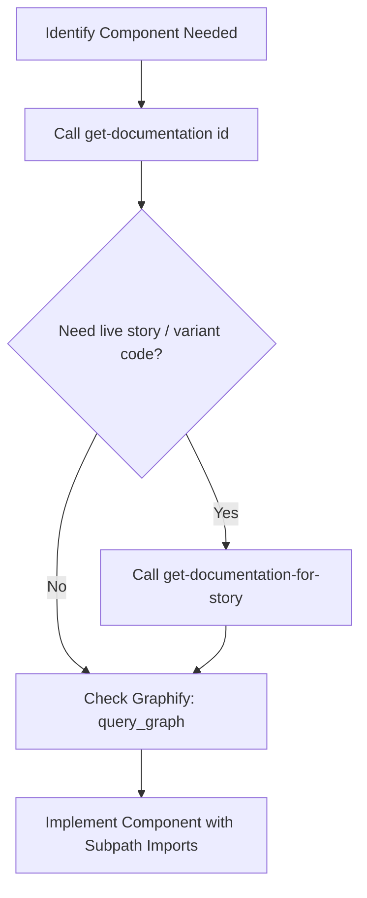

# Skill: Wangs UI Component Fundamentals & MCP Protocol

Use this skill whenever you write or modify UI components using Wangs UI (`@wangs-ui/react-core`, `@wangs-ui/react-icons`, `@wangs-ui/react-presets`, `@wangs-ui/foundation`).

---

## 1. The MCP Discovery Protocol (Mandatory Single Source of Truth)

Do **NOT** guess component props, Pass-Through (`pt`) slots, or event names. Always query the MCP server dynamically to retrieve the current API signatures and live story implementations:



### Discovery Steps:

1. **Inspect Component Contract & Props**:
   ```json
   get-documentation({ "id": "button" })
   get-documentation({ "id": "input" })
   get-documentation({ "id": "datatable" })
   ```
2. **Inspect Live Usage & Story Variants**:
   ```json
   get-documentation-for-story({ "id": "button", "storyName": "Default" })
   get-documentation-for-story({ "id": "datatable", "storyName": "ServerPagination" })
   ```
3. **Inspect Relationships & Real Usages in Graph**:
   ```json
   query_graph({ "query": "DataTable" })
   query_graph({ "query": "usePT" })
   ```

---

## 2. Subpath Modular Imports (Mandatory)

Always import via specific subpaths to guarantee tree-shaking and avoid bundling entire packages:

```tsx
// Primitives (@wangs-ui/react-core/primitive/*)
import Button from '@wangs-ui/react-core/primitive/button';
import Input from '@wangs-ui/react-core/primitive/input';
import NumberInput from '@wangs-ui/react-core/primitive/numberinput';
import Select from '@wangs-ui/react-core/primitive/select';
import Badge from '@wangs-ui/react-core/primitive/badge';
import Card from '@wangs-ui/react-core/primitive/card';
import DataTable from '@wangs-ui/react-core/primitive/datatable';

// Blocks (@wangs-ui/react-core/blocks/*)
import AppLayout from '@wangs-ui/react-core/blocks/applayout';
import Sidebar from '@wangs-ui/react-core/blocks/sidebar';

// Providers & System Hooks
import { WangsUiProvider } from '@wangs-ui/react-core/api';
import { useI18n } from '@wangs-ui/react-i18n';
import { useTheme } from '@wangs-ui/foundation/theme';

// Icons (@wangs-ui/react-icons)
import { SearchLine, AddLine, DeleteBin6Line, CheckLine } from '@wangs-ui/react-icons';
```

---

## 3. Strict Primitive Substitution Rule

Never write raw HTML elements when a Wangs UI primitive exists:

| Forbidden Raw HTML        | Mandatory Wangs UI Component | Subpath Import                               | MCP Documentation ID |
| :------------------------ | :--------------------------- | :------------------------------------------- | :------------------- |
| `<button>`                | `Button`                     | `@wangs-ui/react-core/primitive/button`      | `button`             |
| `<input type="text">`     | `Input`                      | `@wangs-ui/react-core/primitive/input`       | `input`              |
| `<input type="number">`   | `NumberInput`                | `@wangs-ui/react-core/primitive/numberinput` | `numberinput`        |
| `<input type="checkbox">` | `Checkbox`                   | `@wangs-ui/react-core/primitive/checkbox`    | `checkbox`           |
| `<select>`                | `Select`                     | `@wangs-ui/react-core/primitive/select`      | `select`             |
| `<dialog>` / modal        | `Dialog` / `Modal`           | `@wangs-ui/react-core/primitive/dialog`      | `dialog`, `modal`    |
| `<table>`                 | `DataTable`                  | `@wangs-ui/react-core/primitive/datatable`   | `datatable`          |
| Container box             | `Card`                       | `@wangs-ui/react-core/primitive/card`        | `card`               |
| Pill badge / status       | `Badge`                      | `@wangs-ui/react-core/primitive/badge`       | `badge`              |

---

## 4. Typography Scale & 4px Spacing Tokens

### Typography Helper Classes

- `.heading-1` — Page title (22px, 600)
- `.heading-2` — Section / Card title (18px, 600)
- `.heading-3` — Sub-header (16px, 500)
- `.heading-4` — Field label (14px, 500)
- `.heading-5` — Small group header (12px, 600)
- `.p` — Body copy (12px, 500)

### Spacing Tokens

- Gap: `gap-xs`, `gap-sm`, `gap-md`, `gap-lg`, `gap-xl`, `gap-2xl`, `gap-3xl`
- Padding: `p-xs`, `p-sm`, `p-md`, `p-lg`, `p-xl`, `p-2xl`, `p-3xl`
